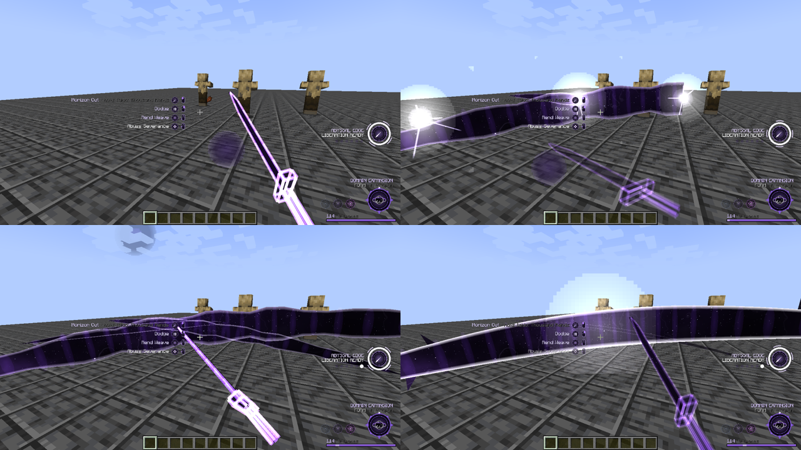

# Abyss

*A recreation of the concept of the "abyss" in Minecraft, built with Claude.*

Standalone Forge 1.20.1 (Forge 47.x) mod. You become the vessel of an infinite dimension, the Abyss. It has an infinite reserve, but you can only push out so much per second (your **output**).

**[Pictures](pictures/)** · **[References & credits](references/)** · **[Releases](releases/)** · **[Changelog](CHANGELOG.md)**

## Getting it
Download the newest jar from [`releases/`](releases/) (currently **[abyss-0.3.2.jar](releases/abyss-0.3.2.jar)**) and put it in your `mods` folder. Requires Minecraft 1.20.1 with Forge 47.x. Older versions are kept in the same folder.

In game, craft an **Abyssal Core** (crying obsidian ×4, echo shard ×2, sculk catalyst ×2, nether star) and use it. There is one Abyss user per world (config `singleUser`). Admins can use `/abyss awaken <player>`.

## Controls (one hand on WASD; all rebindable)
Your skills sit on a wheel. A **form** is an umbrella skill: **R** opens it, and while it is open the four mouse buttons are its sub-actions (hints for them appear next to the crosshair). **R** again closes it. Only one form is open at a time. Vanilla attack and use are blocked while a form is open.

| Key | |
|---|---|
| **X** (tap) | Select the next skill on the wheel |
| **Hold X** | Ability wheel: point and release to select (tap inside it to keep it open and click). **Drag a medallion onto another to swap their places**; the order is saved and is what X tap and X + 1–8 use |
| **X + 1–8** | Use the skill in that place right away (`slotCastsImmediately`; off = only select it) |
| **X + scroll** | Flip through the skills |
| **R** | Use the selected skill, or open / close it if it's a form. Domain: hold to charge (see below). Mash during a Triangle |
| **LMB / RMB / Mouse 4 / Mouse 5** | The open form's four sub-actions |
| **G** | Bodies screen (roster) |
| **H** | The manual (unbound by default; the Guide is also a slot on the wheel) |

## The skills
| Skill | Kind | LMB | RMB | Mouse 4 | Mouse 5 |
|---|---|---|---|---|---|
| **Domain Expansion** | Charge | Sure-Hit Spears | Pressure Pulse | Collapse | Dismiss |
| **Spore Form** | Form | Spread | Paint (hold) | Unleash | Next payload |
| **Abyssal Arsenal** | Form | Attack (hold: heavy) | Dodge | Weapon Skill | Liberation |
| **Authority of the Abyss** | Form | Transport | The Realm | Rift | Rift-step |
| **Beelzebub** | Form | Devour | Brood | Mimic Volley | Inhale |
| **Bodies** | Form | Send clone | Next body | Recall all | Descend |
| **Triangle** | Instant | | | | |
| **Negation** | Toggle | | | | |
| **Guide** | Opens the manual | | | | |

### Domain Expansion
Hold **R** to pour output in, **scroll or right-click to choose Open or Closed**, and release to expand. While your domain stands it becomes your open form, and the mouse commands it:
- **LMB: Sure-Hit Spears.** Crystal spears erupt under every enemy inside. They cannot miss.
- **RMB: Pressure Pulse.** The domain breathes in: everything inside is slammed down and dragged inward.
- **Mouse 4: Collapse.** The finale: everything inside is pulled to the centre and the domain implodes on it.
- **Mouse 5: Dismiss.** Let the domain go.

*Open* pours the abyss into the world. From outside it's a black sphere of galaxy with a white lensing rim and an accretion ring. Inside, the sky is overlaid with galaxy, stars hang in the air, crystal debris rises, and every 2.5 s a pressure pulse slams everything down and inward. Every block is gradually infected: galaxy veins spread over it in **eight stages** (hairline veins → veins → cracks → patches → spreading → bleeding → engulfing → nearly swallowed) without replacing it. Plants wither and water and lava boil off at stage 3, leaves crumble at stage 6, dropped items dissolve. When the domain ends the infection recedes and what withered grows back. The sphere grows at the expansion rate up to what you invested. *Closed* copies the area into an arena in the Abyss and takes everyone inside with it until it ends.

Inside a domain, the weight of the abyss crushes, pins, drags flyers down and corrodes, scaled by the Combat Power gap. **Every one of your abilities is a sure hit:** invulnerability frames are cleared, and hits land even if another mod cancels them.

### Spore Form
Spores swirl around you. Spread them, paint over the ones you want, and turn them all into one payload at once.
- **LMB: Spread.** A 360° burst; hold to keep spreading. **Shift+LMB:** a seeker spore that always latches.
- **RMB (hold): Paint.** Sweep the crosshair: every spore and infected creature it passes over is selected. **Shift+RMB:** plant a spore where you look.
- **Mouse 4: Unleash.** Every selected spore becomes the payload. With nothing selected, it takes everything of yours in front of you, so one press can nuke a whole crowd.
- **Mouse 5: Next payload** (scroll works too; Shift: previous). The payload ring sits around the crosshair.

Payloads: **Nuke** (implodes for about a second, then a sphere of abyss erases what it touches; in a host it goes off from the inside out after an 18-tick build-up, ignoring armor), **Small Domain**, **Beelzebub**, **Transport** to the Abyss, **Disintegrate** (no drops), **Rift**, **Clone Seed**, **Rift-step**.

Spores drift through blocks for 5 minutes. Each spore that meets a creature either **latches on** (weaker creatures are easier to infect) or passes through. Latched spores **corrode** the host, **multiply** inside it, and **jump** to anything it touches.

### Abyssal Arsenal
Forge a weapon of crystal and void; **scroll** to change weapon. See [The Arsenal](#the-arsenal) below.

### Authority of the Abyss
A great rift tears open behind you.
- **LMB: Transport.** Drag what you look at through the rift into the Abyss.
- **RMB: The Realm.** Step through into the Abyss Realm (again: leave). See [The Realm](#the-realm).
- **Mouse 4: Rift.** Open a two-way rift to any coordinates in any dimension the server has, modded ones included. Anything walking in comes out the other side with its momentum.
- **Mouse 5: Rift-step.** Step to where you look. In the Realm: choose which world to exit into.

### Beelzebub
The abyss opens its mouth behind you.
- **LMB: Devour** what you look at: anything below 1.5× your CP (or under 30% HP). Players are bitten instead: they lose 35% HP and you steal their buffs. You keep a share of what you eat: health, damage, armor, speed, extra output, immunities (fire, drowning, flight, undead) and the projectiles it fires.
- **RMB: Brood.** Release a devoured creature as an abyss puppet that fights for you.
- **Mouse 4: Mimic Volley.** Fire the projectiles of the creatures you devoured.
- **Mouse 5: Inhale.** The mouth inhales for three seconds: projectiles, items and the weak are pulled in and swallowed.

### Bodies
- **LMB: Send clone.** A clone climbs out of a rift where you look.
- **RMB: Next body** (Shift: previous). Swapping moves *you* (inventory, camera, keys) into another body and leaves a body behind.
- **Mouse 4: Recall all.** Pull every clone back into the abyss.
- **Mouse 5: Descend.** Put your main body on its throne in the Abyss (you carry on as a clone), or go home to it.

A clone that dies under you throws you back into the main body. If the main body dies, every clone collapses. Clones run on orders (Hold / Follow / Attack / **Mirror** / Patrol) from the Bodies screen (G), and spread spores and detonate infested enemies on their own.

### Triangle, Negation
- **Triangle:** lock what you look at in a tug of war of Combat Power; mash R. The winner shatters the loser's defences (+50% damage taken, every hit lands, 3 s stun, −25% max HP, buffs stripped). If you lose, you are stunned and your negation goes down.
- **Negation:** damage and harmful effects are cancelled while your output lasts. Damage beyond your remaining output leaks through.

Always on: **Soul Resistance** resists 90% of soul-type damage (`#abyss:soul_attacks`, or any damage type whose name contains "soul"). **The Abyss is hostile:** everything it touches corrodes (stacks eat armor and max HP, and stop healing at 5+).

## The Arsenal
Open **Abyssal Arsenal** with R and a construct assembles in your hand out of the void. It sits on the arm bone, so it follows every pose; in first person it's a view model that swings along the same path as the cut it leaves. Nothing moves you except the dodge: every reach is rifts, rends and constructs. Rends are cuts in the air that show the galaxy behind them, hang trembling for a moment, then sever.

| Input | Move |
|---|---|
| **LMB tap** | Basic attack; keep tapping to chain (the chain resets about a second after a move ends) |
| **Hold LMB, release** | Heavy (hold at least 8 ticks) |
| **LMB in the air** | Plunge |
| **LMB right after a perfect dodge** | Counter |
| **RMB** | Dodge: a dash in the direction you're moving (backwards if you're standing still). For a moment you can't be touched; if something hits you then, it's a **perfect dodge**: a slow-motion beat, +10 resonance, and for 2.5 s your next click is the counter |
| **Mouse 4** | Weapon skill (costs output) |
| **Mouse 5** | Liberation: needs the **resonance gauge** at 100 (filled by landing hits; empties on use) and costs 40 output |
| **Scroll** | Forge the next / previous weapon |

Presses during a move are buffered (one), so chains flow without timing. The HUD shows the weapon medallion wrapped in the resonance gauge, the chain pips and the next move. Hits freeze the attacker for a few frames (hit-stop), punch the camera and leave a damage number (`damageNumbers`). Every hit corrodes.

### Abyssal Edge (sword)
A blade so thin it cuts space. Every slash leaves a rend in reality that bleeds galaxy, then severs.

| Input | Move |
|---|---|
| LMB chain | Horizon Cut → Reverse Wane → Crossfold → Thousand Petals → Ascending Sever → Dimension Sever |
| Heavy | Iaido: Thousand Rends |
| Plunge | Falling Rend |
| Counter | Null Step |
| Skill (25) | Rend Weave |
| Liberation | Abyss Severance |

### Event Cleaver (greatsword)
A two-handed slab of crystal. Slow, wide arcs that tear the ground open.

| Input | Move |
|---|---|
| LMB chain | Wide Sweep → Overhead Cleave → Orbit Cleave → Upheaval |
| Heavy | Gravity Cleave |
| Plunge | Meteor Cleave |
| Counter | Riposte |
| Skill (25) | Fault Line |
| Liberation | Sword of the Pit |

### Singularity Maul (hammer)
Each blow is a little collapse: shock rings, craters, gravity wells.

| Input | Move |
|---|---|
| LMB chain | Smash → Uppercut → Twin Quake → Ground Zero |
| Heavy | Collapse Strike |
| Plunge | Starfall |
| Counter | Rebound |
| Skill (30) | Gravity Well |
| Liberation | Collapse |

### Horizon Reaper (scythe)
Sweeping reaps that hook and drag everything inward.

| Input | Move |
|---|---|
| LMB chain | Reap → Wane Reap → Hook → Death Whirl → Eclipse Reap |
| Heavy | Harvest Moon |
| Plunge | Grave Drop |
| Counter | Mirror Reap |
| Skill (30) | Soul Harvest |
| Liberation | Grim Eclipse |

### Rift Lance (spear)
Long piercing thrusts; rifts spit more spears at whatever you point at.

| Input | Move |
|---|---|
| LMB chain | Thrust → Twin Thrust → Crescent Sweep → Piercing Line |
| Heavy | Abyss Drill |
| Plunge | Impale |
| Counter | Counterpoint |
| Skill (25) | Hundred Lances |
| Liberation | Spear of the Abyss |

### Aegis & Shard (bulwark)
A shard blade and a hex shield. **Holding LMB raises the guard** instead of charging: hits from the front are absorbed (you move slowly while guarding), and the damage you absorbed is stored. Releasing fires **Retribution**, which hits harder the more you stored (up to triple damage).

| Input | Move |
|---|---|
| LMB chain | Shield Bash → Shard Slash → Shard Return → Aegis Slam |
| Heavy (hold to guard, release) | Retribution |
| Plunge | Aegis Drop |
| Counter | Perfect Parry |
| Skill (35) | Event Barrier |
| Liberation | Aegis of the Abyss |

### Hands of the Abyss (gauntlets)
Fists of crystal; void arms punch out of rifts around you.

| Input | Move |
|---|---|
| LMB chain | Rift Jab → Cross Hook → Under Rift → Barrage → Converge → Event Horizon |
| Heavy | Abyssal Beam |
| Plunge | Gravity Fold |
| Counter | Thousand-Arm Counter |
| Skill (25) | Rift Lance |
| Liberation | Thousand Hands |

Numbers after "Skill" are the output cost. The manual (Guide) has a chapter for every weapon listing the whole move set; select a move and it plays as a looping diagram of its cuts seen from above.

## The Realm
**Authority → RMB** (25 output): a rift as tall as a house opens behind you and swallows you. The Abyss reflects a world at the same coordinates, so you arrive at the same place, in the galaxy.
- You **fly**, and you **heal** (1 HP and a bit of food every second). Falling out of the bottom puts you back on your throne.
- You see the **souls** of every other player in the reflected world **through walls**: a white spark with a blue halo.
- **Hold LMB: peek.** An eye of the abyss opens at your spot in the reflected world and you look through it (you can look around, not walk away). Release to come back.
- **RMB: leave.** You step out at the same spot, into the world you chose, through a two-way rift.
- **Mouse 5: choose the exit world.** Every world the server has, as a ring of portals: hover, click (or 1–9; scroll when there are many). Until you choose one, you exit into the world you entered from.

The HUD shows a Realm banner, and the crosshair hints change to the Realm's actions.

## The vessel
+20 HP, +6 attack, +10 armor, +6 toughness, knockback resistance and +15% speed (`vesselStrength`). Immune to falling, drowning, suffocation, freezing, fire and lava, starvation, poison and wither (`vesselImmunities`). **Sovereignty:** the vessel can't die. A lethal blow dissolves the body and it re-forms at half health; another lethal blow within 4 s is held in place. Raw `setHealth(0)`, `die()` and removal by other mods are refused (mixins), and max health can't be lowered. `/kill` and the void still work unless `negateVoidAndKill` is on.

## Items
- **Abyssal Core:** become the vessel.
- **Abyssal Upgrade** (creative only, no recipe): use to toggle **infinite output**. Domains charge to their maximum almost instantly, and Liberations don't need the gauge.

## HUD
Bottom right: the selected skill as a big medallion with its neighbours on the wheel beside it, and the output bar under it. When a form is open, four hints sit by the crosshair (mouse button, the sub-action's medallion, its name); they change with context: Shift held, airborne, counter ready, in the Realm. Arsenal adds the weapon medallion and gauge; Spores adds the payload ring.

## Settings
Open **Settings** from the **Config** button in the Mods menu, or from **⚙ Settings** in the manual. Two tabs: **Visuals** (this client) and **World rules** (the server config: editable in singleplayer, read-only on a server). Switches for booleans, sliders for numbers (scroll for fine steps); changes save immediately. Admins can also use `/abyss config`.

Highlights:
- `cooldownsEnabled` (default **false**: no cooldowns, including clone re-forming) and `cooldownMultiplier`.
- `allowInfiniteOutput`
- `domainDecay`, `domainDecayPerTick`, `domainScarsPermanent` (default false: the world heals; true turns fully infected blocks into Abyssal Rot), `domainDissolveItems`
- `sovereignty`, `reformSeconds`, `vesselStrength`, `vesselImmunities`, `comboDamage` (scales Arsenal damage), `beamCarves`
- Visuals: `fxDensity`, `screenShake`, `crystalSkin`, `angelEyesHud`, `domainFog`, `damageNumbers`, `slotCastsImmediately`

## Combat Power (CP)
CP is computed for any living entity from any mod, using:
- **Survival:** health, armor and toughness, immunities, boss status.
- **Offence:** melee damage, ranged and explosive attacks (read from its AI goals), and the biggest hit it has actually landed.
- **Mobility:** speed, flight, teleporting.
- **Powers:** buffs, size, and any modded attribute above its default.

A zombie is about 90. To adjust CP:
- **Datapack:** `data/<ns>/abyss_cp/*.json` with `{"overrides":[{"entity":"iceandfire:fire_dragon","multiply":1.5},{"tag":"forge:bosses","add":500},{"entity":"x:y","set":9000}]}`
- **Command:** `/abyss cp set <targets> <multiplier>`
- **API:** `CombatPower.registerProvider(entity -> multiplier)`

`/abyss cp` inspects whatever you are looking at.

## Commands
`/abyss awaken|revoke|mastery|refill|cast <ability>|cp [targets]|cp set|spores burst|clear|count|clones list|recall|domain end|selftest|config [list|key [value]]`

**Demo** (op, for testing and recording):
- `/abyss demo move <weapon 0–6> <index>` plays one move. Weapons in order: 0 sword, 1 greatsword, 2 hammer, 3 scythe, 4 spear, 5 bulwark, 6 gauntlets. Index: the basic chain from 0, then heavy, plunge, counter, skill, liberation (e.g. the sword's heavy is 6, the hammer's liberation is 8). Opens the Arsenal on that weapon first.
- `/abyss demo form <ability>` opens or closes a form (`spores`, `arsenal`, `authority`, `beelzebub`, `bodies`).
- `/abyss demo fx <type> <a>` plays a raw effect 4 blocks in front of you.

Build: `gradle build` (Java 17) → `build/libs/abyss-<version>.jar`. See CHANGELOG.md.

## Building from source
Requires JDK 17 and Gradle 8.x. Run `gradle build`; the jar lands in `build/libs/`. `gradle runClient` / `gradle runServer` start a dev game. In game, `/abyss selftest` checks the core systems and `/abyss demo move <weapon 0-6> <move>` plays any Arsenal move on cue.

## Open source: use it in your own projects
Everything here is under the **[MIT License](LICENSE)**: the Java source, shaders, textures, icons, sounds, the procedural models, and the jars in `releases/`. You may copy, change and ship any of it in your own mods, packs or projects, commercial or not; just keep the copyright notice from `LICENSE` with it. Useful pieces to lift:

- `client/render/WeaponModel.java` — procedural crystal weapon meshes (sword, greatsword, hammer, scythe, spear, shield, gauntlets) with a galaxy body and glowing edges.
- `shaders/core/void.*` + `client/render/AbyssShaders.java` — the world-anchored galaxy ("window into space") shader.
- `client/render/MoveFx.java` + `combat/Move.java` — a data-driven move timeline (hits + visual primitives on one clock): rends, rift arms, shockwaves, black stars, beams, giant constructs.
- `client/render/FxManager.java`, `Draw.java`, `Rt.java` — the effect renderer and render types.
- `textures/gui/` — Ronova-style medallion icons (generated; the generator scripts are described in the CHANGELOG).
- `client/render/WeaponLayer.java`, `client/FirstPersonWeapon.java` — attaching a custom model to the arm bone in third person and a first-person view model.

Pull requests and forks are welcome.
