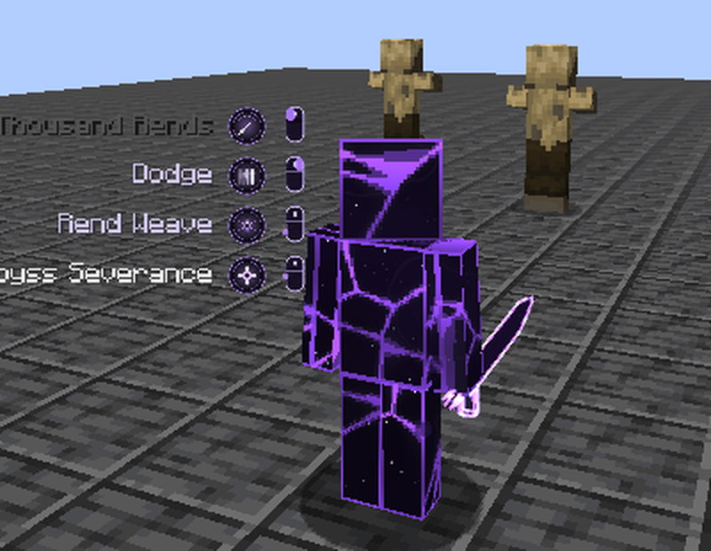
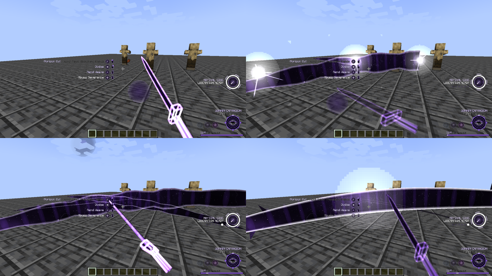
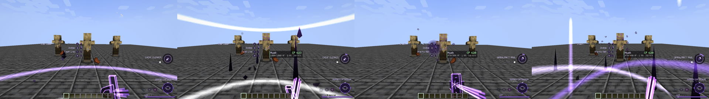
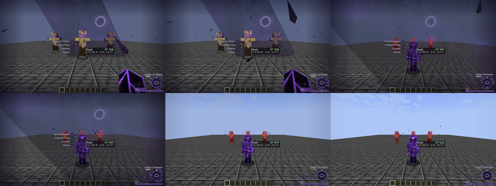
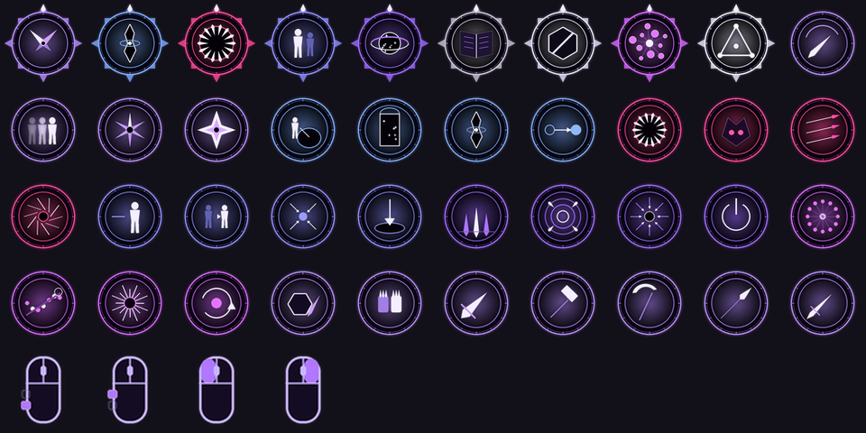
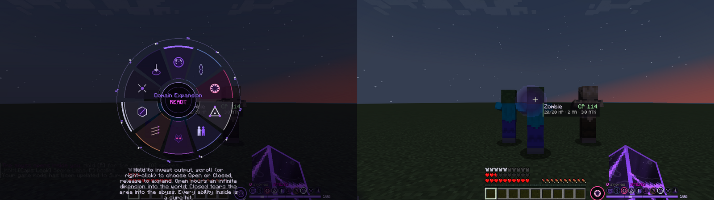
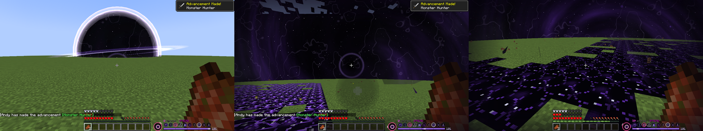
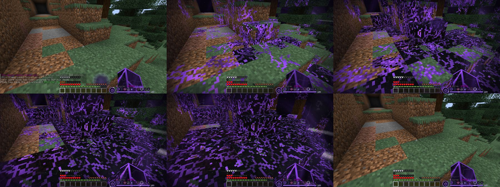
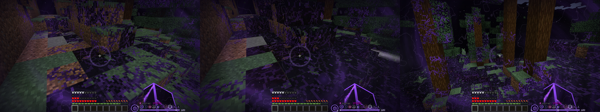
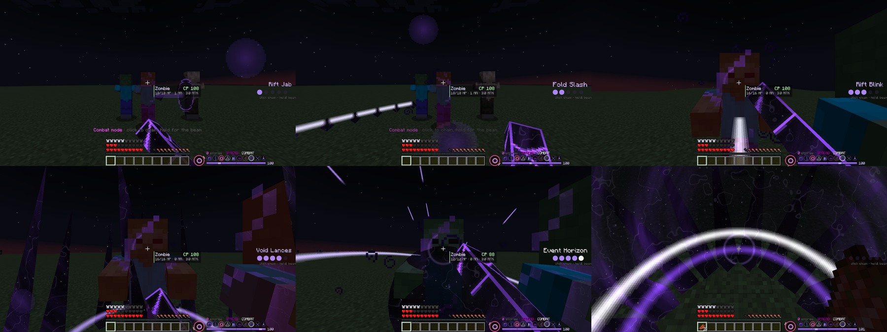

# Pictures

Screenshots and renders of Abyss itself, everything made for this project. Like the rest of the repo, they are MIT-licensed, so feel free to use them.

## 0.3.0 — Forms, the Arsenal and the Realm

**The constructs.** In third person, the weapon sits in the right fist, on the arm bone:

In first person, the weapon has its own view model. Here is Horizon Cut, the first basic attack: the cut tears across the screen and shows the galaxy through it.

**Every move of every weapon, in first person.** One tile per move, in move order: basic chain → heavy → plunge → counter → skill → liberation.

| Weapon | Sheet |
|---|---|
| Abyssal Edge (sword) | [early in each move](0.3/sword-abyssal-edge-a.png) · [later in each move](0.3/sword-abyssal-edge-b.png) |
| Event Cleaver (greatsword) | [sheet](0.3/greatsword-event-cleaver.png) |
| Singularity Maul (hammer) | [sheet](0.3/hammer-singularity-maul.png) |
| Horizon Reaper (scythe) | [sheet](0.3/scythe-horizon-reaper.png) |
| Rift Lance (spear) | [sheet](0.3/spear-rift-lance.png) |
| Aegis & Shard (sword and shield) | [sheet](0.3/bulwark-aegis-and-shard.png) |
| Hands of the Abyss (gauntlets) | [sheet](0.3/gauntlets-hands-of-the-abyss.png) |

The plunges ring you with crystal spikes:

**Domain Expansion.** The galaxy sky is anchored to the world and laid over the real sky, with a black-hole ring on the horizon. Shown with Sure-Hit Spears, Pressure Pulse, and a third-person view:

**Icons.** Medallions for every skill, each form's four sub-actions, the seven weapons, and the mouse buttons:

## 0.2.x

| | |
|---|---|
|  |  |
| Chronoweave-style skill wheel | The 0.2 domain |
|  |  |
| Block infection stages | Infection blending into the world |
|  | |
| The 0.2 combat-mode combo (replaced by the Arsenal in 0.3) | |
